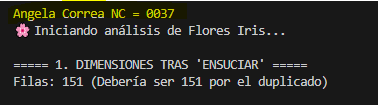
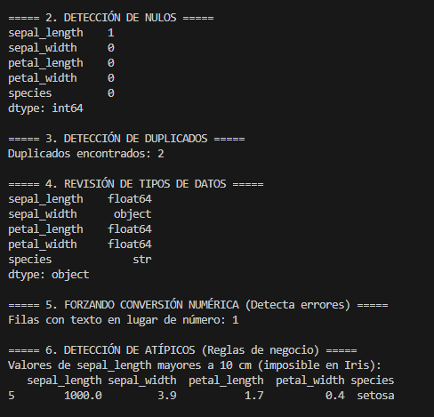
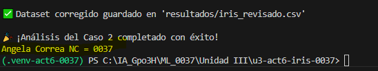
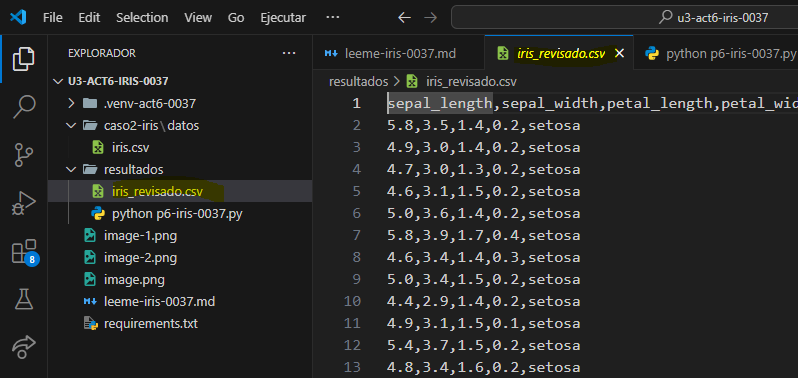

## **Caso 2: Flores Iris** 🌸 (Detección de problemas simulados para aprender a depurar).
Situación: Una escuela quiere clasificar flores Iris. Para aprender, inyectaremos errores intencionales en una copia de los datos y el programa deberá detectarlos.

## Angela Correa NC = 0037

## FASE A: SIMULACIÓN DE ERRORES (¡No tocar en producción real!)

## FASE B: DETECCIÓN Y LIMPIEZA

## FASE C: CORRECCIÓN

## Archivo CSV
